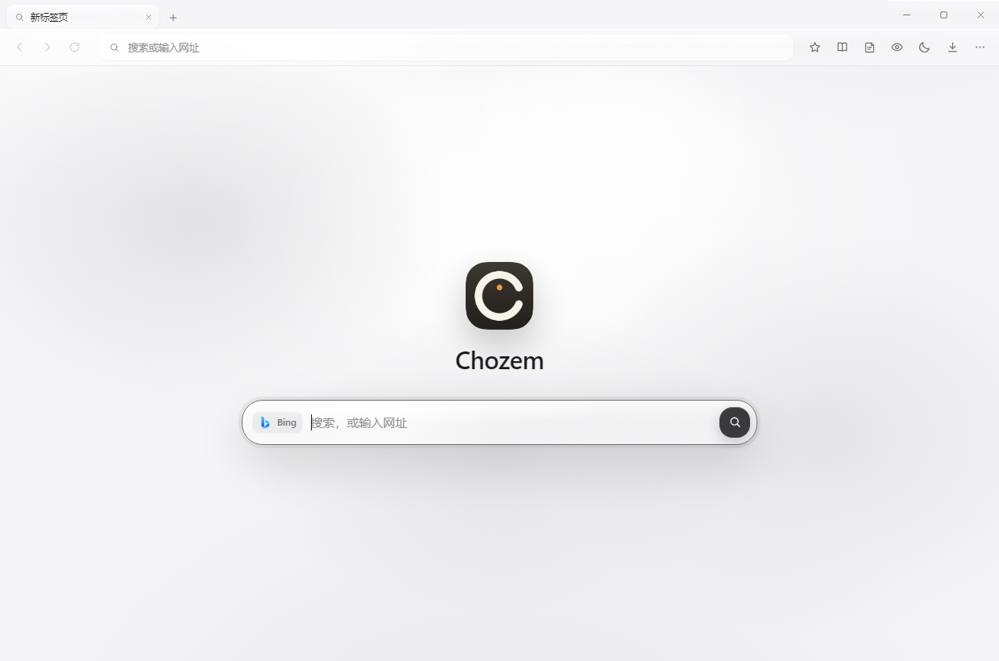
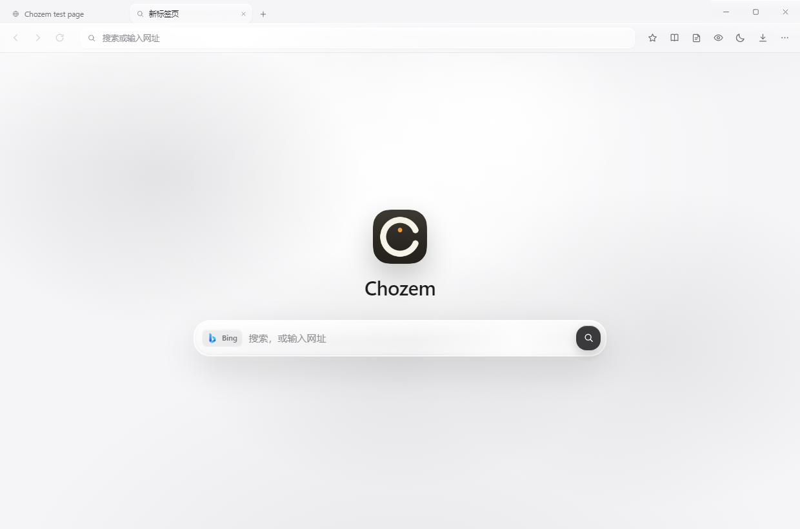
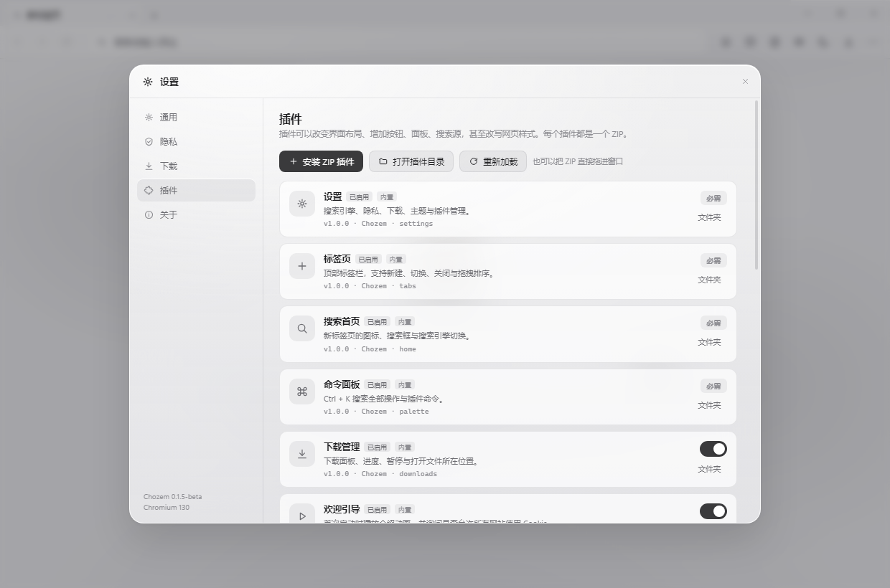
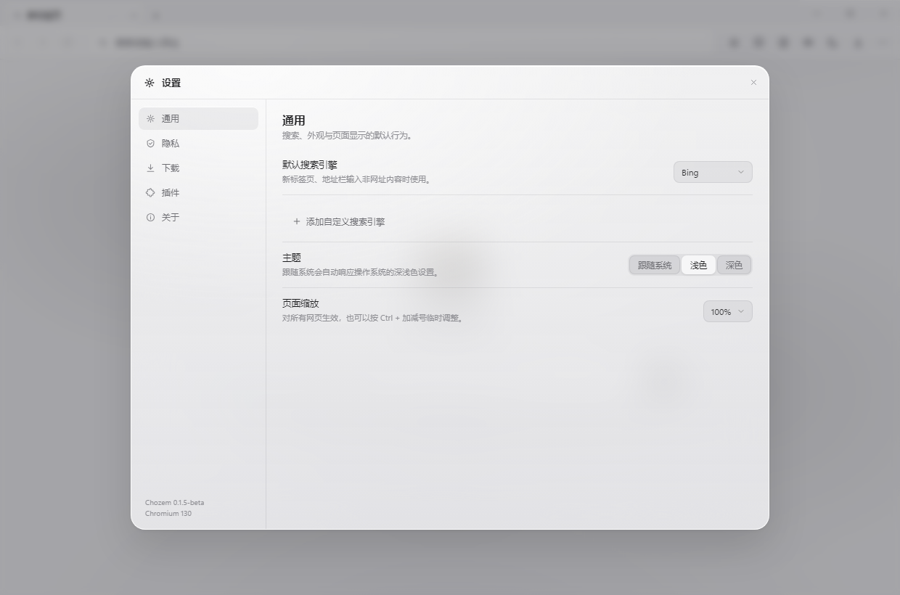
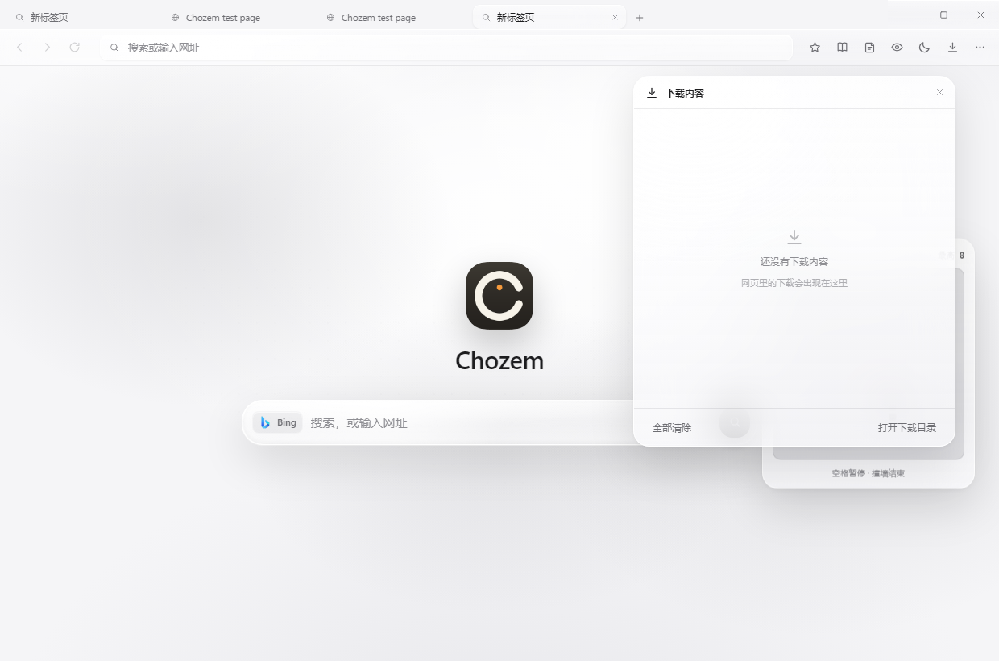
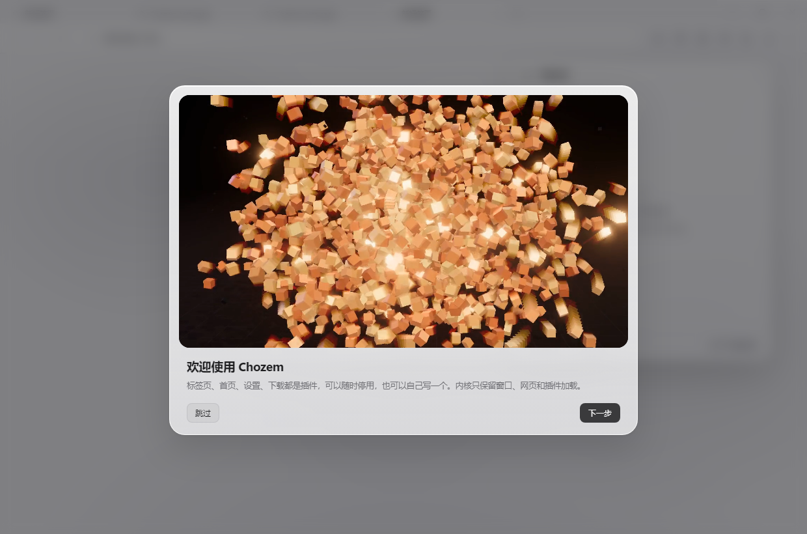
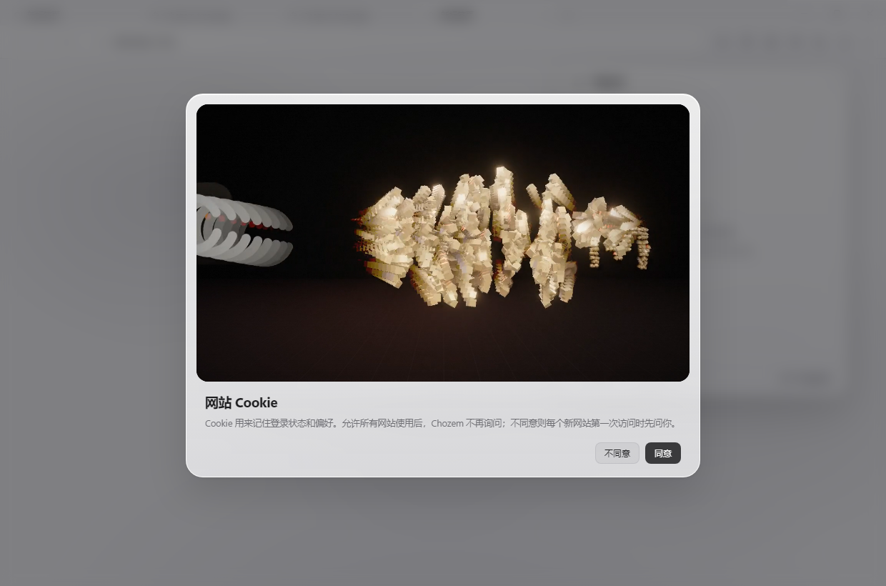
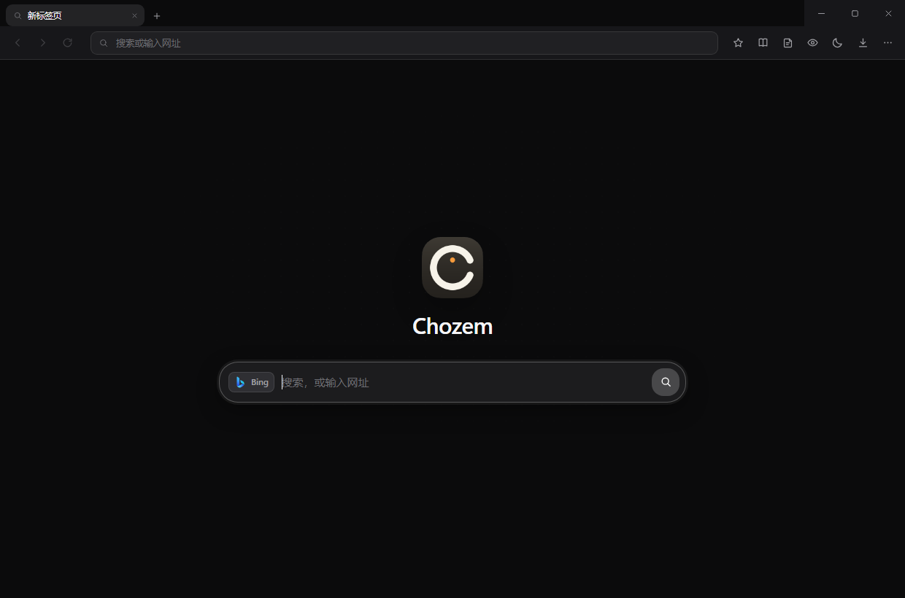
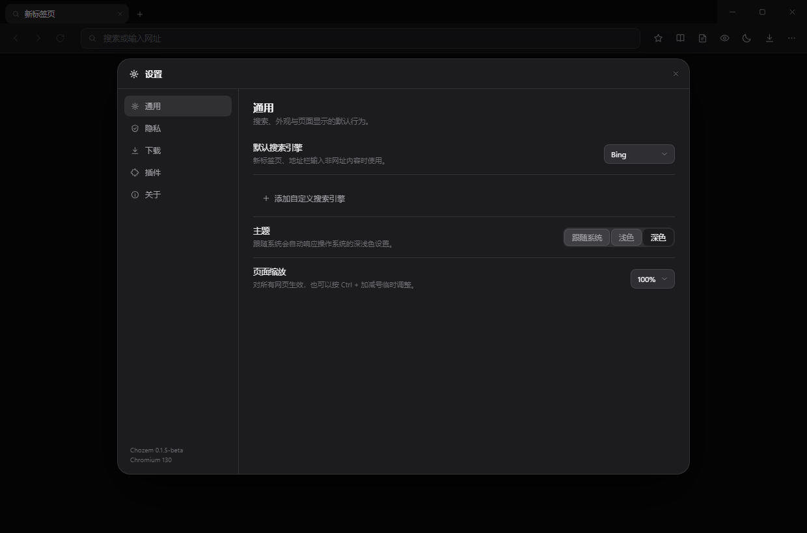

# Chozem

**A minimal browser where everything is a plugin.**

Chozem keeps the kernel deliberately small — window, web views, sessions, plugin loader — and ships
tabs, the home page, settings, downloads, cookies, bookmarks and even the command palette as
**built-in plugins**. Turn a plugin off and that feature genuinely disappears from the UI.

[](#install)
[](#install)
[](#architecture)
[](LICENSE)



## Why

Most browsers are a monolith with an extension API bolted on. Chozem flips that around: the chrome
is a thin shell, and every user-facing feature is a removable plugin written against the same public
API a third-party plugin would use. It is a browser you can rewire from the inside.

- **Kernel ≈ 5.4k lines** (main process + shell + styles). **15 built-in plugins ≈ 2.9k lines.**
- **No framework, no build step.** Plain DOM, plain CSS, one `CHO` namespace.
- **Plugins are ZIP files.** Drop one on the window; it installs, loads and can be disabled again.

## Highlights

- **Tabs as a plugin** — real tab strip with drag-to-reorder, `Ctrl+T` / `Ctrl+W` / `Ctrl+Tab`,
  favicons and badges.
- **Start page as a plugin** — search, engine indicator, extension points for home widgets.
- **Everything is replaceable** — hide the toolbar, build a sidebar, restyle the tab strip, inject
  page CSS/JS, block requests, add settings pages.
- **First run is a plugin too** — `welcome` plays the intro animation and asks once whether sites may
  store cookies. Skip it and it never returns; replay it from `Ctrl+K`.`
- **Apple-gray, with optional liquid glass** — in the light theme the chrome uses a glass material
  (SVG displacement refraction, pointer-tracking specular highlights, translucent panels) shipped as
  a plugin you can switch off. Dark mode is always flat and solid.
- **Per-tab isolation of concerns** — one `<webview>` per tab, shared `persist:chozem` session.

## Built-in plugins

| Plugin | What it does | Disable it and… |
| --- | --- | --- |
| `settings` | Search engine, privacy, downloads, theme, plugin manager | menu / settings entry disappear |
| `tabs` | Tab strip, new/close/reorder, badges | the tab strip is gone |
| `home` | Start page: logo, search field, engine chip, widget slot | new tabs are blank |
| `palette` | `Ctrl+K` command palette | the shortcut does nothing |
| `welcome` | First-run intro videos + one-time cookie consent | new profiles skip the intro |
| `liquid-glass` | Liquid-glass material in light mode: refraction, specular highlights | flat solid surfaces |
| `downloads` | Download panel, progress, pause/open/reveal | toolbar download button hides |
| `cookies` | Per-site cookie viewer / delete / export | cookie entry hides |
| `find` | `Ctrl+F` in-page search | shortcut does nothing |
| `history` | Visit log, search, revisit, clear | menu entry hides |
| `bookmarks` | Star toggle + bookmark panel | star button hides |
| `reader` | Strip clutter, reflow the article | book button hides |
| `quick-notes` | Floating note pad (`Alt+N`) | note button hides |
| `focus-mode` | Hide toolbar and chrome | button hides |
| `midnight-theme` | Override the whole design-token set | button hides |

`settings`, `tabs`, `home` and `palette` are marked `locked` — they cannot be disabled, so the
browser always has a way back.

## Install

### Windows

Grab `Chozem-Setup-0.1.5-beta.exe` from **Releases** and run it. The installer is per-user, lets you
pick the folder, and creates desktop / Start Menu shortcuts plus an uninstaller.

> The build is not code-signed yet, so SmartScreen may warn on first run:
> **More info → Run anyway**. Builds from source avoid that entirely.

### Linux (Debian / Ubuntu)

Pick the package that matches your CPU. Debian calls 64-bit x86 **`amd64`** — that is the same
architecture Windows calls **x64**, and it is what almost every Intel / AMD machine needs.

| Machine | Package |
| --- | --- |
| Intel / AMD (x64) | `Chozem_0.1.5-beta_amd64.deb` |
| ARM64 (Raspberry Pi 4/5, Snapdragon laptops, ARM VMs) | `Chozem_0.1.5-beta_arm64.deb` |

```bash
sudo dpkg -i Chozem_0.1.5-beta_amd64.deb     # or the arm64 one
sudo apt-get install -f                      # only if dependencies are missing
chozem                                       # or launch "Chozem" from the app grid
```

`dpkg` refuses a package whose architecture does not match the machine, so installing the wrong one
fails cleanly with `package architecture (amd64) does not match system (arm64)`.

The package installs to `/opt/Chozem`, adds a desktop entry and an icon, and registers with the
system package manager (`sudo apt remove chozem` to uninstall).

## Quick start

```bash
git clone <repo-url> chozem
cd chozem
npm install
npm start
```

On Windows you can also double-click **`启动 Chozem.cmd`** — it installs dependencies on first run and
clears `ELECTRON_RUN_AS_NODE` if your IDE injected it.

Requirements: Node.js 18+, Windows 10/11, macOS or Linux. User data lives in
`%APPDATA%/Chozem` (Windows) or the platform equivalent.

> The browser UI currently ships in Simplified Chinese; the screenshots below reflect that.
> Documentation is in English and the plugin API is language-neutral.

### Scripts

| Command | Purpose |
| --- | --- |
| `npm start` | Launch the browser |
| `npm run dev` | Launch with DevTools attached to the UI |
| `npm run shot` | Self-test: screenshots + plugin install/enable/badge checks |
| `npm run dist` | Build the Windows installer into `dist/` (NSIS) |
| `npm run dist:linux` | Build the Linux `.deb` into `dist/` (x64 / amd64) |
| `npm run dist:linux:arm64` | Build the Linux `.deb` for ARM64 |
| `npm run plugin:zip -- -Path plugins/foo` | Package a plugin folder into a ZIP |

## Packaging

```bash
npm run dist                # → dist/Chozem-Setup-0.1.5-beta.exe
npm run dist:linux          # → dist/Chozem_0.1.5-beta_amd64.deb
npm run dist:linux:arm64    # → dist/Chozem_0.1.5-beta_arm64.deb
```

Both targets are configured in `package.json` under `build`. Windows uses NSIS (per-user install,
optional directory, shortcuts, uninstaller, user data preserved); Linux uses a Debian package
(`/opt/Chozem`, desktop entry, icon, `dpkg` integration).
CI builds both artifacts when a `v*` tag is pushed (see `.github/workflows/release.yml`).

## Architecture

```
main/            Electron main process
  main.js        window, IPC, plugin broadcasting
  browser.js     session, downloads, cookies, request blocking/headers
  plugins.js     ZIP validation, extraction, enable/disable, manifest normalization
  context.js     native context menu, with plugin-contributed items
preload/         contextBridge whitelist (window.chozem.*)
ui/              the browser chrome itself (a local HTML app)
  index.html     SVG sprite, shell markup, one <webview> per tab
  css/app.css    design tokens, liquid-glass materials, components
  js/view.js     multi-view manager behind Cho.web
  js/plugins.js  plugin host + API injection
  js/app.js      shell wiring, shortcuts, routes, pointer specular
plugins/         15 built-in plugins, each a self-contained folder
SKILL.md         the plugin development specification (feed it to an AI)
examples/        installable demo plugins + ZIPs
```

The kernel exposes capabilities; plugins decide what the browser looks like. The tab strip, for
example, is a `<div id="tab-strip">` placeholder — `plugins/tabs` renders every pixel of it through
`Cho.web`.

## Writing a plugin

A plugin is a folder with a manifest and a plain script:

```
hello/
├─ manifest.json
└─ plugin.js
```

```json
{
  "id": "hello",
  "name": "Hello",
  "version": "1.0.0",
  "main": "plugin.js",
  "icon": "eye"
}
```

```js
Cho.toolbar.addButton({
  icon: 'eye',
  title: 'Say hello',
  onClick: () => Cho.toast('Hello from a plugin'),
});
```

Zip it (manifest at the root), drag it onto the window, done. Disable it in **Settings → Plugins** and
the button disappears — cleanup is automatic.

The full specification — every API, event, design token, and a set of copy-paste recipes — lives in
[`SKILL.md`](SKILL.md). It is written to be handed to an AI: paste it with a feature request and you
get a working plugin back.

### API at a glance

| Namespace | Capability |
| --- | --- |
| `Cho.toolbar` | toolbar buttons (left/right, icons, labels, active state) |
| `Cho.panel` | floating mini windows |
| `Cho.home` | cards on the start page |
| `Cho.web` | tabs: create / activate / close / move / badge / mute / zoom |
| `Cho.page` | run JS, inject CSS/JS, capture PNG, print PDF, context-menu items |
| `Cho.keys` | global shortcuts that work while the page has focus |
| `Cho.menu` | items in the three-dot menu |
| `Cho.settings` | read/write settings, add a whole settings page |
| `Cho.routes` | own `chozem://your-page` |
| `Cho.net` | block URLs, add request headers |
| `Cho.theme` | override any design token |
| `Cho.storage` | per-plugin persistent storage |
| `Cho.system` | window, downloads, cookies, plugins, notifications, clipboard, save file |
| `Cho.services` | cross-plugin service registry |

## Example plugins

| ZIP | Shows |
| --- | --- |
| [`examples/quick-notes.zip`](examples/quick-notes.zip) | panel + storage + shortcut + cleanup |
| [`examples/warm-paper.zip`](examples/warm-paper.zip) | a complete theme pack |
| [`examples/dog-search.zip`](examples/dog-search.zip) | pure-CSS restyling of the start page |
| [`examples/snake-home.zip`](examples/snake-home.zip) | a Canvas game embedded on the home page |

## First run

On a fresh profile the built-in `welcome` plugin shows a two-step intro: a short brand animation,
then a second clip with two buttons — **Don't allow** and **Allow** — that decide whether any site
may store cookies. The video sits in exactly the same place on both steps, and the second clip
starts on the same frame the first one ends on.

- **Allow** → `privacy.cookieConsent = "allowAll"`, no site is ever asked, cookies work normally.
- **Don't allow** → `privacy.cookieConsent = "ask"`. The first visit to each new site raises a
  `Cookie 权限` prompt; clicking **Deny** stops that origin from sending or receiving cookies.
- **Skip** (step 1 only) → treated as *allow*; the intro is marked done and never shown again.

Both states live in `settings.json`, are editable in **Settings → Privacy → Website cookie access**,
and can be replayed from the command palette (*Replay the welcome tour*).

## Screenshots

| Tabs | Plugins |
| --- | --- |
|  |  |

| Settings | Snake plugin |
| --- | --- |
|  |  |

| First run | Cookie consent |
| --- | --- |
|  |  |

| Dark theme | Dark settings |
| --- | --- |
|  |  |

## Keyboard shortcuts

| Action | Shortcut |
| --- | --- |
| New / close tab | `Ctrl+T` / `Ctrl+W` |
| Next tab | `Ctrl+Tab` |
| Focus address bar | `Ctrl+L` |
| Reload / stop | `Ctrl+R` / `Esc` |
| Back / forward | `Alt+←` / `Alt+→` |
| Command palette | `Ctrl+K` |
| Downloads | `Ctrl+J` |
| Find in page | `Ctrl+F` |
| Settings | `Ctrl+,` |
| New window | `Ctrl+N` |
| DevTools | `Ctrl+Shift+I` |
| Zoom | `Ctrl++` / `Ctrl+-` / `Ctrl+0` |

## Privacy

- Everything is stored locally in the user-data directory. Nothing is uploaded.
- Cookies, localStorage and IndexedDB live in a dedicated `persist:chozem` partition.
- Optional: block third-party cookies, send `DNT: 1`, wipe data on exit.
- The cookie manager lists, deletes, exports and clears per-site data.

## Limits and non-goals

- One view layer only: no split view or tab groups (both are writable as plugins).
- No extension store, account sync or built-in PDF reader.
- Network layer can block URLs and add request headers, but **cannot rewrite response bodies**.
  Use `Cho.page.run` / `injectJS` to modify the DOM instead.
- Plugins are trusted code with full UI privileges — install only what you trust.

## Contributing

1. Read [`SKILL.md`](SKILL.md) — it is the contract between the kernel and plugins.
2. Keep the kernel small. If a feature can be a plugin, it should be a plugin.
3. Run `npm run shot` before opening a PR. It captures screenshots into `.design/` and asserts:
   tab create/close, plugin enable/disable, install/uninstall, badges, capture, theme packs and
   error reporting.
4. Built-in plugins are the reference implementations — mirror their structure.

Ideas that fit well: split view, tab groups, a download manager with search, a session manager,
reader-mode typography options, a proper ad-block list UI.

## License

MIT. See [LICENSE](LICENSE).
